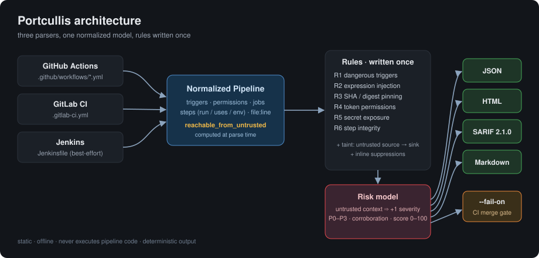
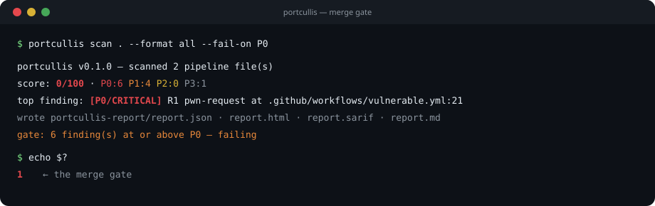
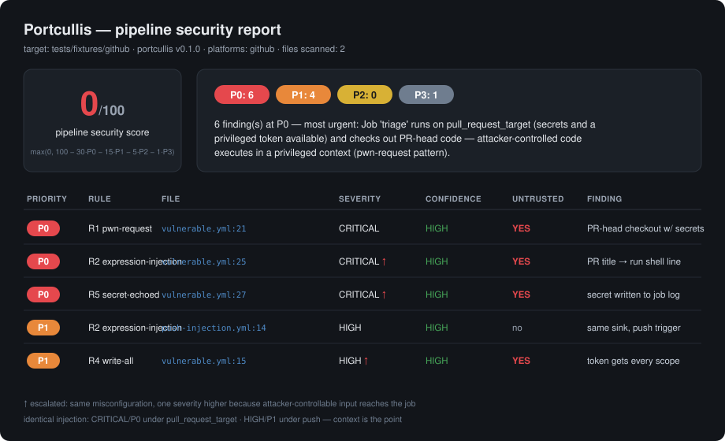

<div align="center">

# 🏰 Portcullis

**Static security analyzer for CI/CD pipeline definitions — GitHub Actions · GitLab CI · Jenkins**

*The gate your pipelines pass through before they can hurt you.*

[](pyproject.toml)
[](LICENSE)
[](#outputs)
[](docs/THREAT_MODEL.md)

</div>

---

CI/CD pipelines hold **repository secrets**, carry **write-capable tokens**, and routinely **execute code from untrusted pull requests**. One misconfiguration — a `pull_request_target` job that checks out PR code, a PR title interpolated into a shell line, a third-party action on a mutable tag — turns that combination into full repository compromise.

Portcullis detects those misconfigurations statically, and — unlike a linter — scores them by **context**: the same flaw is one severity level more dangerous wherever attacker-controlled input can reach it.



## Why another scanner?

Excellent tools exist ([zizmor](https://docs.zizmor.sh/), [poutine](https://github.com/boostsecurityio/poutine), [actionlint](https://github.com/rhysd/actionlint), the [ARGUS](https://www.usenix.org/conference/usenixsecurity23/presentation/muralee) research) — and a [2026 comparative study](https://arxiv.org/html/2601.14455v2) of nine of them found *no single scanner covers all weakness categories*. Portcullis's angle, in full honesty against that landscape ([detailed comparison](docs/COMPARISON.md)):

| | The usual approach | Portcullis |
|---|---|---|
| **Platforms** | per-platform tools (zizmor/actionlint: GitHub-only) | GitHub + GitLab + Jenkins through **one normalized model** — every rule runs on all three |
| **Ranking** | per-rule severities | **trigger-context escalation**: `curl\|bash` on `push` = P2 hygiene; the same step reachable from `pull_request_target` escalates toward P0 |
| **Noise control** | tuning & personas | architecture: confidence is first-class, LOW confidence hard-caps at P3 (surface, don't block), hygiene findings can't corroborate into P0, Jenkins findings honestly capped at MEDIUM |
| **Output** | annotations / JSON | deterministic JSON + self-contained HTML + SARIF 2.1.0 + PR-comment Markdown, with a documented 0–100 score |

## Quickstart

```bash
pip install -e .          # Python 3.11+; single runtime dep: ruamel.yaml (line-number-preserving parser)

portcullis scan .                                  # HTML report → ./portcullis-report/
portcullis scan . --format all --fail-on P0        # all formats + CI merge gate
portcullis rules list                              # rule catalog with false-positive notes
```

Try it immediately on the bundled (inert) vulnerable fixtures:

```bash
portcullis scan tests/fixtures/github --format all --out ./demo-report
```



## What a report looks like



A committed sample generated from the fixtures lives in [docs/sample-report/](docs/sample-report/) — open [`report.html`](docs/sample-report/report.html) locally (fully self-contained, no CDN, works offline) or read the [Markdown flavor](docs/sample-report/report.md).

The key demonstration in that sample: **the identical injection pattern is CRITICAL/P0 under `pull_request_target` and HIGH/P1 under `push`** — context escalation working, marked with `↑` in every output.

## Proven on real-world pipelines

Portcullis was run against **66 real pipeline files from 10 well-known OSS projects** (flask, fastapi, requests, actions/runner, gitlab-runner, jenkinsci/pipeline-examples, …) — full write-up in [docs/EVALUATION.md](docs/EVALUATION.md):

- **Zero crashes** in ~1.4s; malformed files degraded to LOW findings; **0 secret-value leaks** across all four output formats.
- **Sensible ranking**: well-maintained repos scored 95–100, problematic ones scored low with actionable findings.
- **Head-to-head vs [zizmor](https://docs.zizmor.sh) 1.27.0**: directional agreement on which repos are healthy — and Portcullis scanned the GitLab & Jenkins files zizmor reports *"no audit was performed"* on.
- The dataset caught **two calibration bugs** (P0 over-escalation of hygiene; plaintext-secret false positives), both fixed with regression tests — cutting dataset-wide false P0s from 9 to 3 and plaintext FPs from 9 to 0.

**Quality bar:** 175 tests, 95% coverage, every rule `kind` explicitly tested. The **SARIF output is validated against the official SARIF 2.1.0 schema**, and the inert fixtures validate against the real GitHub Actions and GitLab CI schemas.

## Detection rules

| Rule | Checks | Detects |
|---|---|---|
| **R1** Dangerous triggers | `pwn-request` · `dangerous-trigger` · `artifact-poisoning` · `credential-persistence` · `self-hosted-pr` · `mr-untrusted-context` · `pr-context-credentials` | Privileged workflows processing attacker-controllable input: PR-head checkout under `pull_request_target`/`workflow_run`, artifact downloads from untrusted runs, checkout token persistence, self-hosted runners on PRs |
| **R2** Expression injection | `expression-injection` · `env-injection` · `script-injection` · `variable-injection` · `groovy-interpolation` | Untrusted context (PR/issue titles & bodies, comments, refs, MR variables, `CHANGE_*`) landing in shell lines, `$GITHUB_ENV`/`$GITHUB_PATH` writes, `github-script` bodies, double-quoted Groovy `sh` |
| **R3** Pinning | `unpinned-third-party` · `unpinned-first-party` · `image-mutable-latest` · `image-pinned-tag` | Actions on mutable tags/branches instead of commit SHAs; images on `latest`/tags instead of digests |
| **R4** Token permissions | `missing-permissions` · `write-all` · `broad-write` · `secrets-inherit` | Broad-default or `write-all` tokens; blanket secret forwarding into reusable workflows |
| **R5** Secret exposure | `secret-echoed` · `secret-cli-arg` · `secret-untrusted-context` · `plaintext-secret` | Secrets in logs/argv, secrets reachable from untrusted triggers, hardcoded credential-shaped values (**always redacted in output**) |
| **R6** Step integrity | `curl-pipe-shell` · `unverified-download` · `unsecure-commands` | Unauthenticated remote code entering the pipeline; deprecated insecure-commands opt-in |

Every finding carries: `file:line` + YAML key path, evidence snippet, severity (with escalation marker), **confidence (HIGH/MEDIUM/LOW)**, priority P0–P3, and a concrete remediation.

## The risk model (30 seconds)

1. **Escalation first**: any finding inside a job reachable from an untrusted trigger gets +1 severity (R1 exempt — its severity already encodes the trigger).
2. **Severity → priority**: CRITICAL→P0, HIGH→P1, MEDIUM→P2, LOW→P3.
3. **LOW confidence caps at P3** — surface, never block.
4. **Corroboration**: two distinct rules at MEDIUM+/MEDIUM+ on one job bump each other one level (hygiene findings excluded).
5. **Score** = `max(0, 100 − 30·P0 − 15·P1 − 5·P2 − 1·P3)` — printed on every report.

The full (rule-combination → priority) truth table is executable: [`tests/test_risk.py`](tests/test_risk.py).

## Suppressing a finding you've reviewed

```yaml
- uses: example-org/tool@v3   # portcullis: ignore[R3]  — vendored fork, reviewed 2026-07
```

`# portcullis: ignore` (all rules) or `# portcullis: ignore[R2,R5]`, as a trailing comment or on the line above (`//` in Jenkinsfiles). Suppressions are never silent: every output format reports what was suppressed and where.

## As a CI gate

```yaml
- name: pipeline security gate
  run: |
    pip install "portcullis-scanner @ git+https://github.com/<you>/portcullis"  # or pip install -e . in-repo
    portcullis scan . --format sarif --out ./portcullis-report --fail-on P0
```

Exit codes: `0` clean/below threshold · `1` gate tripped · `2` usage error. Portcullis's own CI runs this dogfood — and its own workflow is SHA-pinned, least-privilege, and `persist-credentials: false`, so **Portcullis passes its own scan at 100/100** (enforced by [`tests/test_dogfood.py`](tests/test_dogfood.py)).

## CLI reference

```text
portcullis scan <path>
    --format {json,html,sarif,md,all}   default: html
    --out DIR                           default: ./portcullis-report
    --fail-on {P0,P1,P2,P3}             exit 1 if findings at/above threshold
    --platforms LIST                    subset of github,gitlab,jenkins
    --trusted-actions PREFIX            repeatable; treat prefix as first-party
    --quiet
portcullis rules list
portcullis version
```

## Project layout

```text
src/portcullis/          # src-layout package
  core/        models (normalized Pipeline), risk, taint, engine
  platforms/   github_actions, gitlab_ci, jenkins → one shared model
  rules/       R1–R6, written once against the model
  emitters/    json, html (self-contained), sarif, markdown
  cli.py  logging_config.py  py.typed
tests/         175 tests incl. truth table, determinism, inertness, SARIF-schema
examples/      runnable example repos + Python API + CI-gate snippet
docs/          MkDocs site + THREAT_MODEL, EVALUATION, COMPARISON, benchmarks, spec
.github/       CI, CodeQL, release, docs workflows · issue/PR templates · Dependabot
pyproject.toml  requirements.txt  mkdocs.yml
```

## Guarantees & limitations

**Guarantees** (see [THREAT_MODEL.md](docs/THREAT_MODEL.md)): never executes pipeline content · no network at scan time · malformed input degrades to a LOW finding, never a crash · detected secrets redacted in every format · byte-deterministic output · SARIF validated against the official 2.1.0 schema.

**Limitations** (read before trusting a clean scan): static reachability is approximate — confidence marks that honestly · reusable workflows are followed shallowly · Jenkins/Groovy parsing is best-effort, capped at MEDIUM confidence · high-entropy secret detection has false positives (LOW confidence) · `.gitignore` support is a pragmatic subset · **a clean scan is evidence, not proof**.

## Test fixtures are inert by law

The repo ships deliberately vulnerable fixtures: genuinely misconfigured (real injection sinks, real pwn-request triggers) with harmless `echo` payloads, `example.com` URLs, and fake-marked secret strings. An automated guard ([`tests/test_inertness.py`](tests/test_inertness.py)) enforces this on every run.

## Contributing · Docs

[CONTRIBUTING.md](CONTRIBUTING.md) — add a platform (a parser) or a rule (one function) · [docs/COMPARISON.md](docs/COMPARISON.md) — landscape & prior art · [docs/EVALUATION.md](docs/EVALUATION.md) — real-world results · [docs/VISION.md](docs/VISION.md) — non-goals & roadmap · [CHANGELOG.md](CHANGELOG.md) · [docs/content/](docs/content/) — blog posts & launch kit · original build spec under [docs/spec/](docs/spec/).

## License

Apache-2.0.
