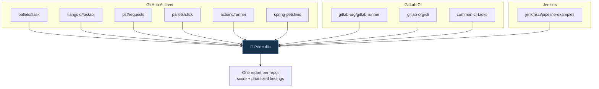
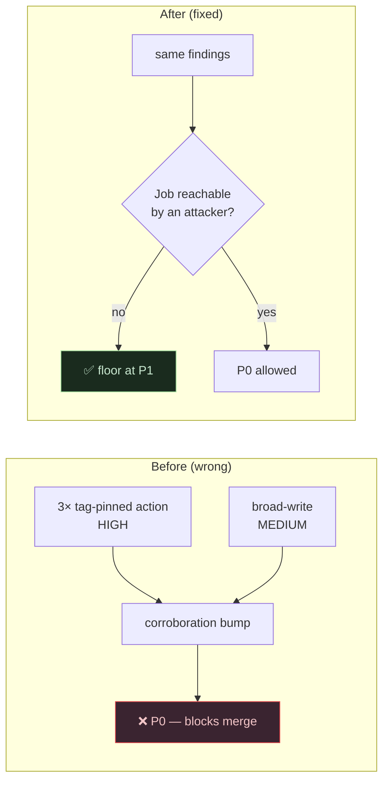
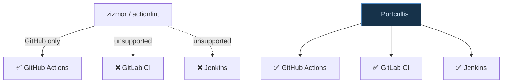

# I Built a CI/CD Security Scanner and Pointed It at 10 Famous Repos. Here's What I Learned.

I built an open-source pipeline security scanner called [Portcullis](https://github.com/<you>/portcullis), and before writing a single word about it I did the thing every tool author should do and most skip: I ran it against real, popular, professionally-maintained projects — Flask, FastAPI, requests, GitHub's own Actions runner, GitLab's runner, Jenkins pipeline examples — and let the results tell me where my tool was wrong.

They did. Twice. And fixing what real data exposed is the whole story.

> **For everyone (non-technical version):** I made a tool that inspects the "build robots" (CI/CD pipelines) software teams use, looking for security mistakes. Testing it only on examples I invented would prove nothing. So I ran it on the pipelines of famous open-source projects that millions of people depend on. The tool held up — no crashes on 66 real files in about a second and a half — but it also *over-reacted* to two harmless things. This post is about finding and fixing that, because a security tool that cries wolf gets switched off.

> **TL;DR**
> - I ran Portcullis over **66 real pipeline files from 10 well-known OSS projects** across GitHub Actions, GitLab CI, and Jenkins.
> - **Zero crashes**, ~1.4 seconds, **zero secret leaks** in any output format.
> - The tool correctly ranked well-maintained repos high and problematic ones low — and **agreed directionally with [zizmor](https://docs.zizmor.sh)**, a mature competing scanner.
> - Real data caught **two calibration bugs** in my own tool. Fixing them cut false criticals by two-thirds.
> - The biggest differentiator held up: Portcullis scanned the **GitLab and Jenkins** files that GitHub-only scanners can't read at all.

## Why this matters

Here's an opinion I'll defend: **a security scanner that hasn't been calibrated against real-world noise is worse than no scanner.** It trains your team to ignore it. The industry even has a name for the death spiral — alert fatigue — and pipeline scanners are especially prone to it because CI configuration is full of things that *look* alarming but are completely normal.

So the interesting engineering question was never "can I detect a pwn-request in a fixture I wrote?" It was "when I point this at 66 files I *didn't* write, does the signal survive contact with reality?"

## The setup

The dataset was deliberately diverse — different platforms, different maintenance cultures, different sizes:



The method is fully reproducible — clone shallow, scan each, done:

```bash
for r in pallets/flask tiangolo/fastapi psf/requests actions/runner; do
  git clone --depth 1 "https://github.com/$r" "$(basename "$r")"
  portcullis scan "$(basename "$r")" --format md --out "reports/$r"
done
```

## What worked: the ranking made sense

The first good sign was that the **security score tracked reality**. Projects with careful, modern pipelines scored high; projects with real hygiene debt scored low, and every low score was backed by findings you could act on.

| Project | Score /100 | What drove it |
|---|---|---|
| gitlab-org/gitlab-runner | **100** | clean |
| gitlab-org/cli, jenkins-examples | **99** | one low-confidence note |
| flask, click | **95** | first-party action pinning (hygiene) |
| requests | **85** | pinning + permissions hygiene |
| spring-petclinic | **27** | unverified downloads + broad permissions |
| actions/runner | **0** | third-party pinning + broad-write on release jobs |

[SCREENSHOT: real-repo-scan — the Markdown report from one of these scans]

The second good sign was **robustness**. Real workflows are messy: matrix builds, reusable-workflow calls, YAML anchors, multi-document files, even a deliberately-broken config in one project's test folder. Portcullis parsed all 66 files in about 1.4 seconds, crashed on none, and degraded the two genuinely-malformed files to low-severity findings instead of blowing up. It also leaked **zero** secret values into any of its four output formats — I check that automatically, on the real data, every run.

## What broke: two calibration bugs (the useful part)

Then the real data did its job and embarrassed me. Twice.

### Bug #1 — hygiene was escalating into "critical"

In GitHub's `actions/runner` repo, three `docker/*` actions pinned to version tags (`@v4`, `@v7`) inside a **manually-triggered** image-publish job were being ranked **P0** — my highest, merge-blocking priority.

That's wrong, and it's wrong in the most damaging way a scanner can be wrong. P0 is supposed to mean *"an attacker can reach this and it's critical — stop the line."* A tag-pinned Docker action on a job a human has to click to run is a *hygiene* issue at most. My scoring had a rule that when two findings corroborate on one job, they bump each other up a level — sensible in general, but it was letting hygiene findings pile up into a false emergency.



The fix encodes the principle directly: **corroboration can only reach P0 when the job is actually attacker-reachable.** On a trusted-trigger job it floors at P1 — "fix this soon," not "stop everything." Result: `actions/runner`'s false P0s went from **6 to 0**, and its worst finding is now an honest P1.

### Bug #2 — the secret detector was jumpy

My rule for hardcoded secrets flags high-entropy strings — the kind of random-looking value that's usually a leaked API key. Real repos are full of high-entropy strings that *aren't* secrets: `platforms: linux/amd64,linux/arm64`, artifact names, a GitHub project URL. All got flagged (correctly at low confidence, so they never blocked anything — but still noise).

The fix was a denylist of structurally-non-secret keys (`name`, `platforms`, `url`, refs…) plus rejecting values shaped like paths, lists, or URLs. Across the dataset, plaintext-secret false positives dropped from **9 to 0** with no loss of genuine detections.

**The aggregate effect** of both fixes on the whole dataset:

| | Before | After |
|---|---|---|
| False/hygiene P0s | 9 | **3** |
| Plaintext-secret FPs | 9 | **0** |
| Genuine detections lost | — | **0** |

The three P0s that *remain* are a single, genuinely-interesting pattern in one project: repository secrets used inside jobs on a `workflow_run` trigger (which can fire off a fork's PR). I'm careful here — that's a pattern worth a human's eyes at *medium* confidence, **not** a claim that the project is exploitable, and its maintainers have already reviewed it. Surfacing it for review is exactly the job.

## The honest competitive check

I didn't want to grade my own homework, so I installed [zizmor](https://docs.zizmor.sh) — a mature, well-regarded GitHub Actions scanner — and ran it on the same inputs. Two things stood out, and I'll report them straight.

**We agree on substance.** On the repos zizmor flagged (`actions/runner`, `spring-petclinic`), Portcullis flagged the same underlying issues — unpinned actions, loose permissions. When an independent tool corroborates your findings, that's the best evidence they're real.

**We differ on philosophy — by design.** zizmor is lint-style: its blanket policy makes *every* unpinned action an error, so it reported 230 findings (66 "high") on `actions/runner` where Portcullis reported 81 with zero P0. Neither is "right" — a 2026 academic comparison of nine scanners found exactly this kind of spread and recommended *combining* complementary tools. Portcullis is deliberately the priority-first, low-noise layer.

**And one difference isn't philosophy — it's coverage.** Pointed at the GitLab and Jenkins files, zizmor exits with *"no audit was performed."* It's GitHub-only. Portcullis read all of them through the same rule set, because every parser normalizes to one shared model. For a team running mixed CI, that's the whole ballgame.



## Key takeaways

- **Test security tools on data you didn't write.** Fixtures prove features; real repos prove calibration.
- **Reserve your top severity for genuine emergencies.** If everything can be critical, nothing is.
- **False positives are a product bug, not a footnote** — treat them with the seriousness of a crash.
- **Corroborate with a competitor.** Agreement validates your signal; disagreement teaches you your philosophy.
- **Breadth beats depth for some users.** One team on three CI systems needs coverage more than a deeper GitHub-only analysis.
- **Publish your limitations.** I did, in the repo — it's the fastest way to earn a security audience's trust.

## Further reading

- [Portcullis on GitHub](https://github.com/<you>/portcullis) — the tool, the fixtures, and the full [`docs/EVALUATION.md`](https://github.com/<you>/portcullis/blob/main/docs/EVALUATION.md) write-up behind this post.
- [zizmor](https://docs.zizmor.sh/audits/) — the scanner I benchmarked against; genuinely good.
- ["Unpacking Security Scanners for GitHub Actions Workflows" (2026)](https://arxiv.org/html/2601.14455v2) — the nine-scanner comparison I cite.
- [ARGUS (USENIX Security 2023)](https://www.usenix.org/conference/usenixsecurity23/presentation/muralee) — large-scale taint analysis of workflows.
- [poutine](https://github.com/boostsecurityio/poutine) — another multi-platform pipeline scanner worth knowing.
