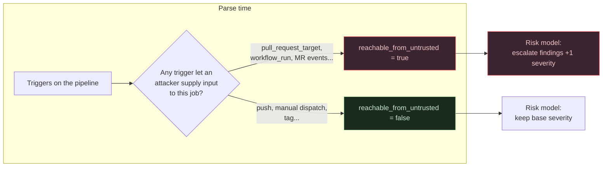
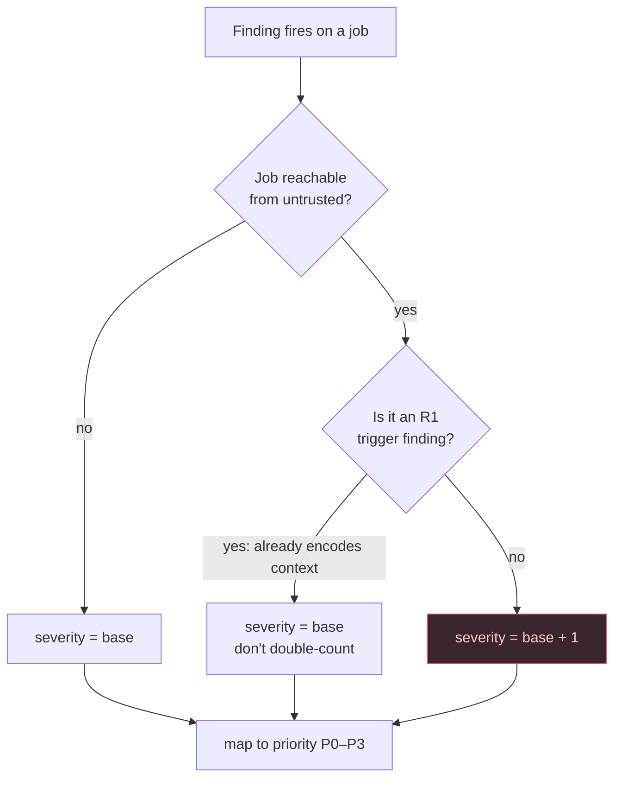

# Context Is Everything: The Insight That Makes a Pipeline Scanner More Than a Linter

Two pipeline jobs contain the identical line: `curl https://example.com/install.sh | bash`. One is a P2 hygiene note you'll get to next sprint. The other is a P0 you should block the merge over. The line is the same. What differs is *who can reach it* — and encoding that difference is the single design decision that separates a useful pipeline scanner from a YAML linter that drowns you in noise.

> **For everyone (non-technical version):** Imagine a security guard who flags "an unlocked door." Useful — but an unlocked *janitor's closet* and an unlocked *bank vault* are not the same alarm. A dumb scanner treats them identically and buries you in warnings. A smart one asks *"can a stranger actually reach this door?"* and only sounds the big alarm when the answer is yes. This post is about how to build the smart version.

> **TL;DR**
> - Most pipeline scanners rank findings by a fixed per-rule severity. That produces noise, because the same issue has wildly different real risk depending on context.
> - The load-bearing idea in [Portcullis](https://github.com/<you>/portcullis) is **trigger-context escalation**: a finding inside a job an attacker can reach is bumped one severity level.
> - This requires computing *reachability* at parse time and threading it through a priority model — not just matching patterns.
> - Done right, it keeps hygiene as hygiene and lifts genuine incidents to the top, so the tool stays trusted.

## Why this matters

The failure mode of static analysis isn't missing bugs — it's crying wolf. Every security engineer has watched a scanner get switched off because it produced 400 findings and the 3 that mattered were indistinguishable from the 397 that didn't. For pipeline security this is acute, because CI configuration is *dense* with patterns that are risky in one place and completely fine in another.

So the interesting problem isn't "can I pattern-match a `curl | bash`?" Any regex can. It's "can I tell the dangerous one from the benign one automatically?" That requires modeling context, and context in a pipeline means one thing above all: **can attacker-controlled input reach this job?**

## The core concept: reachability, then escalation

Every parser in Portcullis normalizes its platform (GitHub Actions, GitLab CI, Jenkins) into one shared model. The pivotal field on that model is a boolean computed at parse time for every job: `reachable_from_untrusted`.



Then the risk model applies one rule that carries most of the tool's judgment:

> **A finding inside a job where `reachable_from_untrusted` is true is escalated one severity level.** The same misconfiguration is genuinely more dangerous where attacker-controllable input can reach it.

That's it. That's the insight. Everything else — priorities, the score, the report — is bookkeeping on top of it.

## How it actually works

### Step 1: compute reachability from triggers

The parser classifies each trigger. On GitHub, `pull_request_target` and `workflow_run` provide secrets to code paths an outsider can influence, so any job under them is `reachable_from_untrusted`. A plain `push` or `workflow_dispatch` is not. On GitLab, merge-request-triggered jobs are reachable; on Jenkins, the presence of change-request context (`CHANGE_*`) marks a stage reachable.

Because this is computed once per job and stored on the model, **every rule gets it for free** — no rule has to re-derive "is this dangerous here?"

### Step 2: escalate, with two deliberate exceptions



The exceptions matter for honesty. A rule that *itself* detects a dangerous trigger (the pwn-request rule) already bakes context into its base severity, so escalating it again would double-count. And a low-confidence finding is capped at the lowest priority no matter what, because escalating something you're unsure about is how you manufacture false criticals.

### Step 3: turn severity into a priority you can gate on

Severity maps to priority P0–P3, then two more deterministic passes run: a **corroboration** bump (two independent rules firing on one job raise each other, because two problems in one place is worse than one) and a **confidence floor** (low-confidence findings never block). Priorities feed a documented 0–100 score:

```
score = max(0, 100 − 30·P0 − 15·P1 − 5·P2 − 1·P3)
```

Nothing here is a black box. The entire (findings → priority) mapping is an executable truth table in the test suite, so the scoring can't silently drift.

## The attack surface this catches that linters miss

Consider the concrete payoff. Here are two jobs with the *same* injection sink:

```yaml
# Job A — on: push
- run: echo "commit ${{ github.event.head_commit.message }}"   # HIGH → P1

# Job B — on: pull_request_target
- run: echo "title ${{ github.event.pull_request.title }}"     # HIGH → escalated → CRITICAL → P0
```

A linter that scores by rule gives both the same severity, and you either over-react to Job A or under-react to Job B. Portcullis gives Job A a P1 ("real, but not externally reachable") and Job B a P0 ("attacker input reaches a shell with secrets present"). That's the difference between a tool you tune out and a tool you gate merges on.

[SCREENSHOT: html-report — showing the same rule at CRITICAL/P0 under pull_request_target and HIGH/P1 under push, with the ↑ escalation marker]

I verified this survives real-world contact: on the evaluation dataset, the escalation logic was exactly what correctly separated one project's genuinely-interesting `workflow_run`-plus-secrets pattern (P0, flagged for review) from dozens of identical-looking-but-benign hygiene findings on trusted-trigger jobs (P1/P2, don't block). Same rules, different context, correctly different priorities.

## Defenses this design encodes (and you should copy)

If you're building any kind of security ranker, three principles from this generalize:

1. **Model reachability explicitly, once.** Don't let each rule guess at context. Compute "can an attacker get here?" in one place and thread it through.
2. **Reserve your top bucket for reachable criticals.** P0/critical must mean *"block the line."* If hygiene can climb into it, the bucket is worthless.
3. **Make confidence first-class and let it cap priority.** Escalating uncertain findings is the fastest way to lose your users' trust.

## Key takeaways

- **Severity is not a property of a pattern — it's a property of a pattern *in a context*.**
- **Compute attacker-reachability at parse time** and store it on your model so every rule benefits.
- **Escalate findings in reachable jobs**, but exempt findings that already encode context and cap low-confidence ones.
- **Keep the scoring auditable** — a truth table beats a vibe.
- **The goal is trust:** a scanner is only useful if people leave it turned on.

## Further reading

- [Portcullis on GitHub](https://github.com/<you>/portcullis) — the normalized model, taint engine, and risk truth table described here are all in [`portcullis/core/`](https://github.com/<you>/portcullis/tree/main/portcullis/core).
- [ARGUS (USENIX Security 2023)](https://www.usenix.org/conference/usenixsecurity23/presentation/muralee) — the deepest published take on source→sink reachability in workflows.
- [zizmor's persona/confidence model](https://docs.zizmor.sh/audits/) — a different, well-designed approach to the same noise problem.
- ["Unpacking Security Scanners for GitHub Actions Workflows" (2026)](https://arxiv.org/html/2601.14455v2) — quantifies how differently scanners rank the same findings.
- [GitHub Actions security hardening](https://docs.github.com/en/actions/security-guides/security-hardening-for-github-actions) — the underlying threats, from the vendor.
